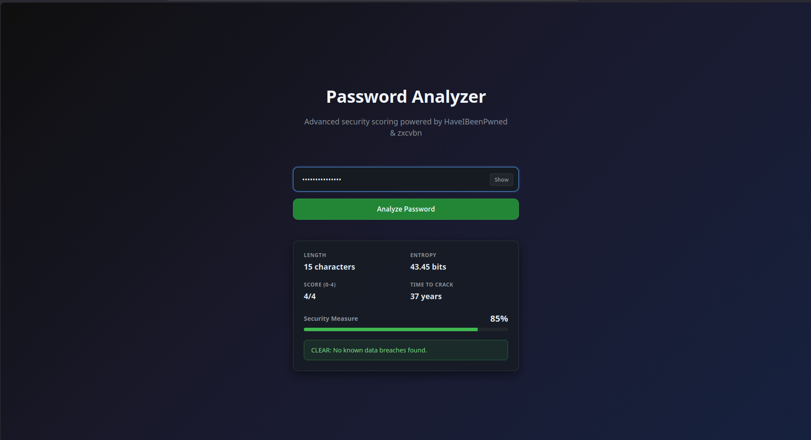

# Password Analyzer

Password Analyzer is a modern React and FastAPI web application designed to evaluate password security using industry-standard tools and a professional interface.



It analyzes password length, entropy, and overall strength, and cross-references them with the HaveIBeenPwned database to identify compromised passwords.

---

## Features

- **Advanced Strength Estimation**: Powered by the zxcvbn library for realistic security scoring.
- **Data Breach Detection**: Uses the HaveIBeenPwned API to check if passwords have appeared in known leaks.
- **Detailed Insights**: View entropy, time-to-crack estimates, and actionable security suggestions.
- **Premium Interface**: A modern dark mode design with glassmorphism effects and fluid animations.
- **Real-time Feedback**: Instant results as you analyze your passwords.

---

## Technical Stack

- **Frontend**: React (Functional Components, Hooks)
- **Backend**: FastAPI (Python)
- **Security Logic**: zxcvbn, HaveIBeenPwned API
- **Styling**: Vanilla CSS with custom properties and backdrop filters
- **Deployment**: Docker Compose

---

## Deployment

The application is fully containerized for easy deployment.

### Prerequisites

- Docker
- Docker Compose

### Run the Application

```bash
docker-compose up --build
```

The frontend will be available at http://localhost:3000 and the backend API at http://localhost:8000.

---

## API Endpoints

### POST /api/check-password

Analyzes a password and returns a detailed security report.

**Request Body:**
```json
{
  "password": "your-password-here"
}
```

**Response Example:**
```json
{
  "length": 15,
  "entropy": 45.3,
  "strength": "medium",
  "score": 2,
  "breached": false,
  "count": 0,
  "safety_percent": 55,
  "crack_time_display": "2 years",
  "warning": "This is a predictable password",
  "suggestions": ["Add another word or two"]
}
```
